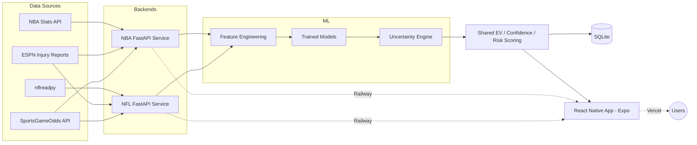

# PropMetrics

**Live demo:** https://propmetrics.vercel.app/

A two-sport (NFL + NBA) machine learning platform that predicts player prop outcomes (points, assists, rebounds, 3-pointers made, passing/rushing/receiving yards, and more), prices them against real sportsbook odds, and surfaces expected-value picks through a shared mobile app.

This repo is a showcase only — architecture, results, and methodology, with no source code. The implementation lives in private repos.

---

## Architecture

Two independently deployed FastAPI backends (one per sport), each with its own data pipeline and model architecture, feeding a single shared React Native frontend. Confidence, risk, and expected-value scoring logic is ported byte-for-byte between the two services so a "HIGH confidence" or "+EV" badge means the same thing regardless of sport.

---

## Results

Hit rates are **directional accuracy** (did the model correctly call over/under), not profitability — reported with sample size and baseline so they're checkable, not just stated.

| Sport | Hit Rate | Sample Size | Tested Against |
|---|---|---|---|
| NFL | **55.8%** | 1,054 picks | Real archived sportsbook lines |
| NBA | **58–62%** | 7,096 picks | Each player's own recent-form average* |

\* No historical NBA sportsbook-line archive existed before this project started one — NBA's number will become market-validated once enough real lines accumulate, the same way NFL's did.

At standard -110 odds, a bettor needs **52.4%** to break even. NFL's 55.8% is a real **3.4-point edge over the market**, validated against actual archived book lines, not a proxy baseline.

---

## Tech Stack

**Backend:** Python, FastAPI, scikit-learn, Polars (NFL) / Pandas (NBA), SQLite, Docker
**ML:** Quantile-regression Gradient Boosting (NFL) with a volume × efficiency decomposition; Random Forest / Gradient Boosting / Linear Regression ensemble (NBA) with Monte Carlo uncertainty estimation
**Data:** nflreadpy, NBA Stats API, ESPN injury reports, SportsGameOdds API (real-time sportsbook odds)
**Frontend:** React Native (Expo), TypeScript
**Infra:** Railway (backends), Vercel (frontend)

---

## What it does

- Ingests live player stats, team/opponent context, and injury status for 200+ players per sport.
- Engineers 45+ leakage-safe features per sport (rolling averages, exponentially-weighted recent form, head-to-head history, opponent-adjusted context, usage rate) — validated with out-of-sample permutation-importance testing, not hand-picked.
- Trains and backtests models with a real train/test split; a custom harness checks both directional accuracy and probability calibration before anything ships.
- Prices every prediction against live sportsbook odds and flags real expected-value edges, with confidence and risk scoring so a pick's badge reflects how much the underlying model actually stands behind it.
- Serves everything through a shared mobile app with live injury badges, real odds, and per-pick reasoning.

---

## Screenshots

*(add app screenshots or a short GIF here)*

---

## Notes on methodology

This project has an explicit policy of not shipping a claim it hasn't verified. A few examples from the build process:
- A feature-importance study was run (and a real bug in it fixed) before promoting any candidate feature into production — most candidates tested (pace, opponent defensive rating, schedule density) came back statistically indistinguishable from noise and were **not** promoted, even though they were already written.
- An uncertainty-engine upgrade (quantile regression replacing an assumed-Normal distribution) was built, backtested, and found to **not** clearly improve calibration yet at current data volume — it's kept in the codebase but deliberately not used in production until a future backtest shows real improvement.
- A season-boundary bug was caught where the model was training on last season's final games instead of the current season's — fixed by blending both seasons' data rather than a naive cutover, which collapsed accuracy to a coin-flip before the fix.
